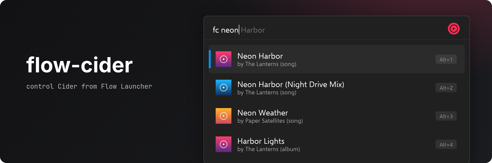

<!-- generated by readwright from docs/README.md.j2; edit the template, not this file -->


# Flow Cider

Search Apple Music and control the Cider 1.x player from Flow Launcher.

[](https://github.com/Garulf/flow-cider/actions/workflows/tests.yml) [](https://github.com/Garulf/flow-cider/releases/latest) [](https://github.com/Garulf/flow-cider/blob/main/LICENSE)

[](https://www.buymeacoffee.com/garulf) [](https://github.com/sponsors/Garulf)

## Features

* **Search Apple Music.** Songs and albums from the Apple Music catalog, with cover art.
* **Play from the search bar.** `Enter` plays the song or album in Cider.
* **Queue and rate.** Play next, play later, love, dislike and add to your library from the context menu.
* **Now playing.** Type `fc` on its own to see the current track and pause or resume it.
* **Filters.** Narrow results by artist or by type, and change how many come back.

## Usage

Type `fc` followed by a song, album or artist:

```
fc neon
```


Type `fc` with nothing after it to see what is playing. Press `Enter` to pause or resume:


### Filters

Add options anywhere in the query. End the query with `:` to list them:

| Option | Example | Result |
| --- | --- | --- |
| `:limit <n>` | `fc neon :limit 5` | At most `n` songs and `n` albums (default 20) |
| `:by <artist>` | `fc city :by m83` | Only results whose artist is exactly that name. Works for one-word names |
| `:type <songs\|albums>` | `fc harbor :type albums` | Only songs or only albums |


### Context menu

Open the context menu (`Shift+Enter` or right-click) on a result to queue it, rate it or add it
to your library:


## Installation

Download `flow-cider-<version>.zip` from the [latest release](https://github.com/Garulf/flow-cider/releases/latest) and unzip it into
`%appdata%\FlowLauncher\Plugins`, then restart Flow Launcher.

Pre-releases of the next version are published from the open release PR on the
[releases page](https://github.com/Garulf/flow-cider/releases) for testing. Flow Launcher won't offer them as updates.

## Requirements

* [Cider](https://cider.sh) 1.x (Cider Classic) running, with its websocket API on port `26369`.
  Cider 2 and later replaced that API, so this plugin does not work with them.
* Flow Launcher 1.17.0 or newer
* Python 3.8 or newer, which Flow Launcher can install for you

## License

MIT
